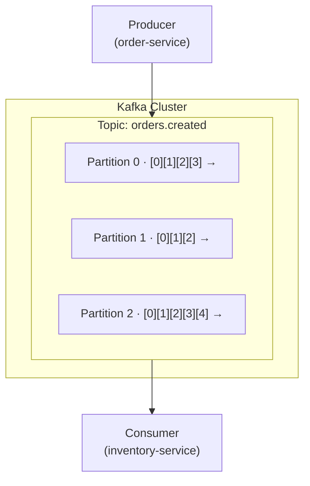
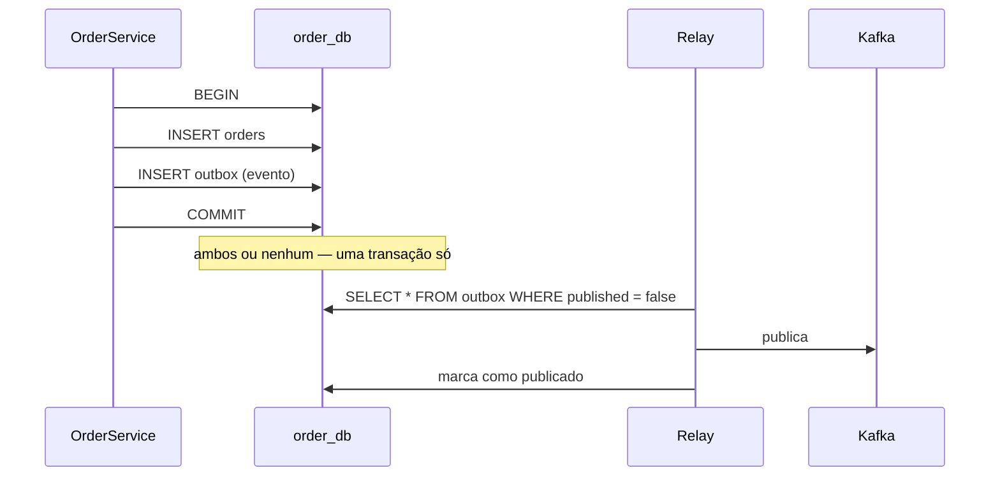
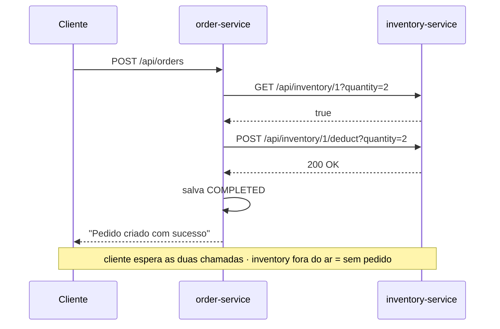
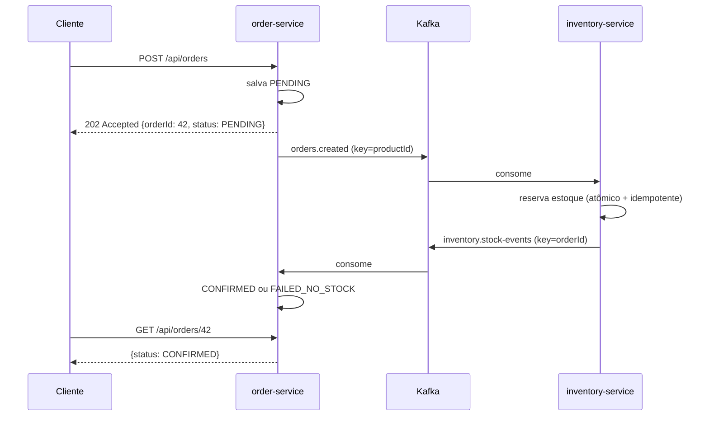

# Kafka — Guia de estudos aplicado ao `ecommerce-microservices`

> Material escrito para quem nunca usou mensageria. A ordem é: **entender o problema → entender o Kafka → praticar no console → só então mexer no código.**
>
> Cada conceito é amarrado ao que já existe neste repositório, para não virar teoria solta.

**Índice**

1. [Por que mensageria? O problema no seu código](#1-por-que-mensageria-o-problema-no-seu-código)
2. [Síncrono vs assíncrono, comando vs evento](#2-síncrono-vs-assíncrono-comando-vs-evento)
3. [Anatomia do Kafka](#3-anatomia-do-kafka)
4. [Kafka vs RabbitMQ](#4-kafka-vs-rabbitmq)
5. [As armadilhas: entrega, idempotência, dual write](#5-as-armadilhas-entrega-idempotência-dual-write)
6. [Spring Kafka na prática](#6-spring-kafka-na-prática)
7. [Laboratório — mão na massa antes do código](#7-laboratório--mão-na-massa-antes-do-código)
8. [O desenho da solução para este projeto](#8-o-desenho-da-solução-para-este-projeto)
9. [Roteiro de implementação](#9-roteiro-de-implementação)
10. [Para aprofundar](#10-para-aprofundar)

---

## 1. Por que mensageria? O problema no seu código

Hoje, `OrderService.placeOrder()` (`order-service/src/main/java/com/swetonyancelmo/service/OrderService.java:21`) faz isto:

```java
@Transactional
public String placeOrder(CreateOrderDTO dto) {
    Boolean hasStock = inventoryGateway.checarEstoque(dto.productId(), dto.quantity());  // HTTP #1

    if (Boolean.TRUE.equals(hasStock)) {
        inventoryGateway.deduzirEstoque(dto.productId(), dto.quantity());                // HTTP #2
        // ... salva o Order como COMPLETED
```

Parece inocente. Tem quatro problemas, e é importante entender cada um **antes** de aprender a ferramenta — senão você aprende Kafka sem saber o que ele está resolvendo.

### 1.1 Acoplamento temporal

O pedido **só existe** depois que o `inventory-service` responder. Se ele estiver fora do ar, o circuit breaker abre, o fallback lança `InventoryUnavailableException` e o cliente recebe um erro. **Nenhum pedido é registrado.** Do ponto de vista do negócio isso é perda de venda: o cliente quis comprar, e você jogou a intenção dele no lixo porque um serviço interno de estoque caiu.

Repare que o circuit breaker que você já implementou **não resolve** isso — ele só evita que a falha do inventory derrube o order. É contenção de dano, não disponibilidade. Mensageria muda a natureza da coisa: o pedido é aceito e persistido imediatamente, e a baixa de estoque acontece quando o inventory estiver de pé.

### 1.2 Race condition (TOCTOU)

`TOCTOU` = *Time Of Check to Time Of Use*. Você **checa** na linha 23 e **usa** na linha 26. Entre uma coisa e outra existe uma janela:

```
Pedido A: checa produto 1, quantidade 10 → tem 10 em estoque → true
Pedido B: checa produto 1, quantidade 10 → tem 10 em estoque → true
Pedido A: deduz 10 → estoque = 0
Pedido B: deduz 10 → estoque = -10   ← vendeu o que não tinha
```

A lição vale para qualquer arquitetura: **verificar-e-agir precisa ser uma única operação atômica**. Duas chamadas HTTP nunca serão atômicas. No desenho assíncrono, o inventory recebe *"reserve 10 unidades do produto 1"* e decide sozinho, dentro de uma transação de banco — sem janela.

### 1.3 Bug ativo: pedido `COMPLETED` sem baixa de estoque

Em `inventory-service/src/main/java/com/swetonyancelmo/service/InventoryService.java:29`:

```java
if (inventory.getQuantity() < quantity) {
    return new InsufficientStockException("Estoque insuficiente para o produto " + productId).getMessage();
}
```

Isso **constrói** a exceção e devolve a `String` da mensagem — não lança nada. O controller devolve **HTTP 200 OK** com o texto de erro no corpo. Do outro lado, `InventoryGateway.deduzirEstoque()` é `void` e ignora o retorno do Feign. Resultado: o `order-service` acha que deu tudo certo e salva `COMPLETED`, **sem que uma única unidade tenha saído do estoque**.

Na prática esse caminho é raro hoje porque o `checarEstoque` filtra antes — mas é exatamente a race condition de 1.2 que faz ele acontecer. Dois bugs que se escondem mutuamente.

> Correção: `throw` em vez de `return`. Vamos arrumar isso na implementação.

### 1.4 Transação de banco aberta durante I/O de rede

`@Transactional` na linha 21 abre uma transação no `order_db` e a mantém aberta durante **duas chamadas HTTP** (até 2s de connect + 3s de read cada, pelo `application.yml`, e com retry de 3 tentativas). Uma conexão do pool fica presa esse tempo todo sem fazer nada. Com 20 requisições simultâneas e um pool HikariCP padrão de 10 conexões, o serviço trava — não por causa do banco, mas porque as conexões estão esperando a rede.

**Regra**: nunca faça chamada remota dentro de uma transação de banco.

---

## 2. Síncrono vs assíncrono, comando vs evento

### 2.1 Os dois modelos

**Síncrono (o que você tem):** A chama B e **espera**. A precisa saber o endereço de B, e B precisa estar vivo agora. Se B demora, A demora. Se B cai, A sente.

```
order ──── "tem estoque?" ────► inventory
      ◄──────── "sim" ─────────
```

**Assíncrono (para onde vamos):** A escreve uma mensagem num broker e **segue a vida**. Quem lê, quando lê e se lê é problema de outro. A não conhece B.

```
order ──► [ Kafka ] ──► inventory
```

O broker vira um **amortecedor**: absorve picos de carga, guarda mensagens enquanto o consumidor está fora do ar, e permite plugar novos consumidores sem tocar no produtor. Se amanhã você criar um `notification-service` que manda e-mail a cada pedido, ele só se inscreve no tópico — o `order-service` não muda uma linha.

### 2.2 O preço: consistência eventual

Não existe almoço grátis. Ao ir para assíncrono, você troca **consistência imediata** por **consistência eventual**.

Hoje: `POST /api/orders` devolve `"Pedido criado com sucesso"` — a resposta já é a verdade final.

Depois: `POST /api/orders` devolve `202 Accepted` com `{"orderId": 42, "status": "PENDING"}`. O status definitivo (`CONFIRMED` ou `FAILED_NO_STOCK`) chega alguns milissegundos depois. O cliente descobre consultando `GET /api/orders/42`.

Isso **não é uma gambiarra** — é como e-commerce de verdade funciona. Quando você compra na Amazon, o pedido é aceito na hora e o status ("preparando", "confirmado", "cancelado — sem estoque") evolui depois. A consistência imediata era uma ilusão que só se sustentava porque o sistema era pequeno.

**Entender essa troca é o conceito mais importante deste guia.** Mensageria não é "HTTP mais rápido" — é um modelo diferente de consistência.

### 2.3 Comando vs evento

Distinção que confunde muita gente e define como você nomeia as coisas:

| | **Comando** | **Evento** |
|---|---|---|
| Semântica | "faça isto" | "isto aconteceu" |
| Tempo verbal | imperativo — `ReserveStock` | passado — `OrderCreated` |
| Destinatários | um, específico | zero ou N, o emissor não sabe |
| Acoplamento | o emissor sabe quem executa | o emissor não sabe quem escuta |
| Pode ser recusado? | sim, é um pedido | não, é um fato consumado |

Kafka favorece **eventos**. A regra prática: **nomeie no passado**. `OrderCreated`, `StockReserved`, `StockRejected`. Se você se pegar escrevendo `SendEmailCommand` num tópico Kafka, provavelmente está usando o Kafka como fila de tarefas — o que funciona, mas joga fora a maior parte do valor dele.

---

## 3. Anatomia do Kafka

### 3.1 A ideia central: Kafka não é uma fila

Esse é *o* mal-entendido a desfazer logo no começo.

Numa fila tradicional (RabbitMQ, SQS), a mensagem é **entregue e removida**. É uma caixa de correio: chegou a carta, você pega, a caixa esvazia.

Kafka é um **log append-only, particionado, distribuído e durável**. É um **livro-caixa**: eventos são anexados no fim, nunca removidos por terem sido lidos, e cada leitor mantém seu próprio **marcador de página**. Dez leitores diferentes leem o mesmo evento, cada um no seu ritmo. A mensagem some por **política de retenção** (idade ou tamanho), não por consumo.

Consequências enormes:

- Um novo serviço pode nascer hoje e **reprocessar todos os eventos da última semana** para construir seu estado.
- Se seu consumidor tinha um bug, você **corrige, volta o marcador e reprocessa**. Isso é impossível numa fila tradicional — a mensagem já foi.
- O Kafka aguenta terabytes de retenção porque é só escrita sequencial em disco, que é rapidíssima.

Guarde a imagem: **livro-caixa com marcadores de página**, não caixa de correio.

### 3.2 Vocabulário



**Broker** — um servidor Kafka. Vários brokers formam um **cluster**. Você vai rodar um só.

**Topic** — o nome da categoria de eventos. `orders.created`. É só um nome lógico; o dado mora nas partições.

**Partition** — aqui está a mágica. Um tópico é dividido em N partições, e cada partição é um log ordenado e independente. Partições permitem **paralelismo**: 3 partições = até 3 consumidores do mesmo grupo trabalhando ao mesmo tempo.

**Offset** — a posição de um registro dentro de uma partição. Um número que só cresce: 0, 1, 2, 3... É o "número da linha" no livro-caixa. O consumidor guarda "já processei até o offset 57 da partição 1".

**Record** — o que trafega. Tem `key`, `value`, `headers` e `timestamp`.

**Producer** — quem escreve. Decide a partição assim:
- Se você define uma **key** → `hash(key) % número_de_partições`. **Mesma key sempre cai na mesma partição.**
- Se não define key → distribuição balanceada entre as partições.

**Consumer** e **Consumer Group** — leitores. Um grupo é identificado por um `group.id`, e a regra fundamental é:

> **Dentro de um consumer group, cada partição é atribuída a exatamente um consumidor.**

Isso resolve duas necessidades opostas com um único mecanismo:

- **Mesmo `group.id`** = dividir trabalho. 3 partições, 3 instâncias do `inventory-service` no grupo `inventory-group` → cada uma pega uma partição, cada evento é processado **uma vez** pelo serviço. É assim que você escala horizontalmente.
- **`group.id` diferente** = broadcast. `inventory-group` e `notification-group` recebem **cada um** uma cópia de todos os eventos. É assim que vários serviços reagem ao mesmo fato.

Corolário importante: **mais consumidores que partições = consumidores ociosos.** Com 3 partições e 5 instâncias, 2 ficam paradas. O número de partições é o teto do seu paralelismo, e mudá-lo depois é chato (quebra a garantia de que a mesma key vai para a mesma partição). Pense nisso ao criar o tópico.

**Rebalance** — quando um consumidor entra ou sai do grupo, o Kafka redistribui as partições. Durante o rebalance o consumo pausa brevemente. Consumidor lento que estoura o `max.poll.interval.ms` é expulso do grupo → rebalance → mais lentidão. Causa clássica de instabilidade em produção.

**Commit de offset** — como o consumidor diz "processei até aqui". Se você commitar **antes** de processar e falhar no meio, perdeu a mensagem (*at-most-once*). Se commitar **depois** e falhar entre processar e commitar, vai reprocessar (*at-least-once*). Voltamos nisso na seção 5.

**Retention** — `retention.ms` (padrão 7 dias) e `retention.bytes`. Passou disso, o segmento antigo é apagado. Existe também **compaction**: em vez de apagar por idade, o Kafka mantém apenas o **último** registro de cada key — vira uma tabela de estado atual, útil para "changelog" de entidades.

**Replication** — cada partição tem um **leader** e N **followers** em outros brokers. `replication.factor=3` em produção. Num cluster de 1 broker, só dá para usar 1 — sem tolerância a falha, o que é aceitável para estudo, jamais para produção.

**ISR** (*In-Sync Replicas*) — as réplicas em dia com o leader. `acks=all` significa "só me confirme depois que todas as ISR gravaram".

### 3.3 Ordenação — uma decisão de arquitetura

> **O Kafka garante ordem apenas DENTRO de uma partição. Nunca entre partições.**

Frase para tatuar. Se você joga eventos do mesmo pedido em partições diferentes, eles **podem** ser processados fora de ordem, e nenhuma configuração conserta isso.

Então a **escolha da key** é uma decisão de projeto, não um detalhe:

- Key = `productId` → todos os eventos do produto 1 na mesma partição → processados em série → **zero contenção no banco** para aquele produto.
- Key = `orderId` → todos os eventos do pedido 42 em ordem → o status nunca "volta no tempo".
- Sem key → máximo paralelismo, zero garantia de ordem.

Cuidado com **hot partition**: se 80% dos pedidos são do mesmo produto, essa partição vira gargalo enquanto as outras ficam ociosas. Escolher key é balancear ordem contra distribuição.

### 3.4 KRaft — esqueça o ZooKeeper

Tutoriais antigos mandam subir ZooKeeper junto. **Não precisa mais.** Desde o Kafka 3.3 existe o **KRaft**, em que o próprio Kafka gerencia os metadados via protocolo Raft; no Kafka 4.0 o ZooKeeper foi **removido de vez**. Se um tutorial pede ZooKeeper, ele é anterior a 2023 — o resto do conteúdo provavelmente também está velho.

### 3.5 Garantias do producer

Três parâmetros que valem a pena conhecer:

**`acks`** — quando o producer considera a escrita bem-sucedida:
- `acks=0` — nem espera. Rapidíssimo, perde dados.
- `acks=1` — espera só o leader. Se o leader morrer antes de replicar, perdeu.
- `acks=all` — espera todas as ISR. **Use isto** para eventos de negócio. É o padrão desde o Kafka 3.0.

**`enable.idempotence=true`** (padrão desde 3.0) — o producer numera as mensagens e o broker descarta duplicatas causadas por retry de rede. Elimina a duplicação **do lado do producer** — mas não a do consumidor, que é a que vai te morder.

**`retries` / `delivery.timeout.ms`** — quantas vezes e por quanto tempo o producer tenta antes de desistir.

---

## 4. Kafka vs RabbitMQ

Você escolheu Kafka, mas precisa saber o que **não** escolheu — essa comparação cai em entrevista.

| | **Kafka** | **RabbitMQ** |
|---|---|---|
| Modelo | Log distribuído append-only | Broker de filas (AMQP) |
| Após consumir | Mensagem **permanece** (retenção por tempo) | Mensagem é **removida** (ack) |
| Reprocessar | Sim — volta o offset e relê | Não — a mensagem já foi |
| Roteamento | Simples: tópico + partição por key | Rico: exchanges (direct, topic, fanout, headers), bindings |
| Ordem | Garantida por partição | Garantida por fila (com 1 consumidor) |
| Throughput | Altíssimo (milhões/s) | Alto, mas uma ordem de grandeza abaixo |
| Vazão do consumidor | Consumidor controla (pull) | Broker empurra (push), com prefetch |
| Retry/DLQ | Manual (tópicos de retry + DLT) | Nativo e mais simples |
| Mensagem agendada / prioridade | Não tem | Tem (plugins/filas de prioridade) |
| Curva de aprendizado | Mais íngreme | Mais suave |
| Encaixe natural | Event streaming, event sourcing, analytics, saga | Filas de tarefas, RPC assíncrono, roteamento complexo |

**Regra de bolso:**

- Precisa de **histórico de eventos, replay, vários consumidores independentes do mesmo fluxo, alto volume**? → Kafka.
- Precisa de **fila de trabalho, roteamento sofisticado, retry/DLQ prontos, prioridade, agendamento**? → RabbitMQ.

Para este projeto, Kafka é a escolha certa: o próximo item do roadmap é o **padrão Saga**, que é literalmente uma coreografia de eventos, e o replay + a retenção deixam o mecanismo visível — você consegue *ver* a saga acontecendo no log.

---

## 5. As armadilhas: entrega, idempotência, dual write

Esta seção é o que separa "fiz um hello world de Kafka" de "sei usar mensageria". Leia com atenção.

### 5.1 Semânticas de entrega

**At-most-once** — commita o offset antes de processar. Falhou? A mensagem se perde. Aceitável para métricas e logs. Inaceitável para pedidos.

**At-least-once** — processa e só então commita. Se o processo morrer entre uma coisa e outra, a mensagem é reentregue e processada de novo. **É o padrão do Spring Kafka e o que você vai usar.**

**Exactly-once** — o santo graal. O Kafka oferece EOS via transações, mas com uma pegadinha grande: só vale **de Kafka para Kafka**. No instante em que seu consumidor escreve num banco PostgreSQL, a transação do Kafka e a do Postgres são coisas separadas, e o "exactly-once" evapora.

> **A conclusão prática, e é ela que importa:** assuma **at-least-once** e torne seus consumidores **idempotentes**. Isso é mais simples, mais robusto e mais honesto do que perseguir EOS.

### 5.2 Idempotência — obrigatória, não opcional

**Idempotente** = processar a mesma mensagem N vezes tem o mesmo efeito de processar uma vez.

Sem isso, uma reentrega em `deductStock` **baixa o estoque duas vezes**. Não é hipotético: rebalance, redeploy, timeout de rede — tudo causa reentrega. Vai acontecer.

Duas formas de resolver:

**a) Tabela de eventos processados** — genérica, funciona sempre:

```sql
CREATE TABLE processed_events (
    event_id     UUID PRIMARY KEY,
    processed_at TIMESTAMP NOT NULL DEFAULT CURRENT_TIMESTAMP
);
```

No consumidor, dentro da **mesma transação** que faz o trabalho: tente inserir o `event_id`. Violou a PK? Já processou, ignore.

**b) Chave natural única** — mais elegante quando existe. No nosso caso, um pedido só pode gerar **uma** movimentação de estoque:

```sql
CREATE TABLE stock_movements (
    id         BIGSERIAL PRIMARY KEY,
    order_id   BIGINT NOT NULL UNIQUE,   -- ← a idempotência mora aqui
    product_id BIGINT NOT NULL,
    quantity   INT    NOT NULL,
    ...
);
```

Prefira (b) neste projeto: você ganha idempotência **e** uma trilha de auditoria do estoque de graça, sem tabela técnica extra. O `UNIQUE(order_id)` é a garantia — o banco te protege, não o código.

> O ponto crítico: a marcação "já processei" e o trabalho em si precisam estar na **mesma transação de banco**. Se forem transações separadas, você só empurrou o problema um passo adiante.

### 5.3 O problema do dual write

Este é sutil e derruba muita gente. Olhe o código que parece óbvio:

```java
@Transactional
public void placeOrder(...) {
    orderRepository.save(order);            // escrita 1: PostgreSQL
    kafkaTemplate.send("orders.created", e); // escrita 2: Kafka
}
```

Dois sistemas diferentes, sem transação distribuída entre eles. Dois jeitos de quebrar:

- **Commit no banco, falha no Kafka** → pedido existe, evento nunca sai, o pedido fica `PENDING` para sempre.
- **Envio para o Kafka, rollback no banco** → o inventory baixa o estoque de um pedido **que não existe**.

O segundo é pior e é o mais provável: `kafkaTemplate.send()` é **assíncrono**, então ele já despachou quando o `@Transactional` decide dar rollback.

**Solução nível 1 — `@TransactionalEventListener(AFTER_COMMIT)`:** publica apenas depois que o commit do banco deu certo. Mata o segundo caso, que é o perigoso. Sobra a janela pequena de "commitou e o Kafka caiu logo em seguida". É o que vamos usar primeiro — simples, e resolve 90% do risco.

**Solução nível 2 — Transactional Outbox:** a resposta correta e completa.



O evento é gravado **na mesma transação** que o pedido, numa tabela `outbox`. Um processo separado (um `@Scheduled` simples, ou CDC com Debezium) lê a tabela e publica no Kafka. Nunca há divergência: se o pedido existe, o evento existe. O relay pode publicar duas vezes se cair na hora errada — mas o consumidor é idempotente (5.2), então tudo bem.

Vamos fazer nível 1 primeiro e o outbox como fase opcional, para você ver a diferença na prática.

### 5.4 Poison message e DLQ

**Poison message**: uma mensagem que sempre falha — JSON malformado, produto que não existe, bug no consumidor. Sem tratamento, o consumidor tenta, falha, não commita, recebe de novo, falha... **loop infinito, e a partição inteira para atrás dela.**

Solução: depois de N tentativas, mande a mensagem para uma **Dead Letter Topic** (`orders.created.DLT`), commite o offset e siga em frente. A mensagem fica guardada para análise humana sem travar o fluxo.

No Spring Kafka isso é um `DefaultErrorHandler` com `DeadLetterPublishingRecoverer`.

Distinção importante ao configurar isso:

- **Erro transitório** (banco fora do ar, timeout) → tem sentido tentar de novo.
- **Erro permanente** (JSON inválido, regra de negócio violada) → retry nunca vai funcionar, mande direto para a DLT.

O `DefaultErrorHandler` aceita `addNotRetryableExceptions(...)` justamente para separar os dois casos.

### 5.5 Consumer lag

**Lag** = último offset produzido − último offset commitado pelo grupo. É a métrica número um de saúde de um sistema Kafka. Lag crescendo = seus consumidores não dão conta da produção. Você vai ver isso no Kafka UI durante o laboratório.

---

## 6. Spring Kafka na prática

### 6.1 Dependência

```xml
<dependency>
    <groupId>org.springframework.kafka</groupId>
    <artifactId>spring-kafka</artifactId>
</dependency>
```

Sem `<version>` — o `spring-boot-starter-parent` (4.1.0, que você já usa) gerencia.

### 6.2 Produzir

```java
@Service
@RequiredArgsConstructor
public class OrderEventPublisher {

    private final KafkaTemplate<String, OrderCreatedEvent> kafkaTemplate;

    public void publish(OrderCreatedEvent event) {
        kafkaTemplate.send("orders.created",
                           String.valueOf(event.productId()),  // ← a key define a partição
                           event);
    }
}
```

`send()` devolve um `CompletableFuture`. Não faça `.get()` nele dentro de um fluxo web — isso transforma seu envio assíncrono em síncrono e traz de volta o problema que você está tentando resolver. Se precisar saber do resultado, use `.whenComplete((result, ex) -> ...)` para logar a falha.

### 6.3 Consumir

```java
@Component
@RequiredArgsConstructor
public class OrderCreatedListener {

    private final InventoryService inventoryService;

    @KafkaListener(topics = "orders.created", groupId = "inventory-group")
    public void onOrderCreated(OrderCreatedEvent event) {
        inventoryService.reserveStock(event);   // método idempotente
    }
}
```

Ao retornar normalmente, o offset é commitado. Ao lançar exceção, entra o error handler (retry → DLT).

### 6.4 A pegadinha da serialização JSON

É aqui que todo mundo trava no primeiro dia, então preste atenção.

O `JsonSerializer` do Spring adiciona um header `__TypeId__` com o **nome completo da classe** do produtor. O `JsonDeserializer` lê esse header e tenta instanciar **exatamente essa classe** no consumidor. Se os pacotes não baterem, você toma `ClassNotFoundException`. E mesmo se baterem, você acabou de acoplar os dois serviços pelo nome do pacote Java — o oposto do que a mensageria deveria dar.

A configuração certa: **ignore o header e diga explicitamente qual classe esperar.**

```yaml
spring:
  kafka:
    bootstrap-servers: localhost:9092
    producer:
      key-serializer: org.apache.kafka.common.serialization.StringSerializer
      value-serializer: org.springframework.kafka.support.serializer.JsonSerializer
      acks: all
      properties:
        spring.json.add.type.headers: false      # não polua com o tipo Java
    consumer:
      group-id: inventory-group
      auto-offset-reset: earliest
      key-deserializer: org.apache.kafka.common.serialization.StringDeserializer
      value-deserializer: org.springframework.kafka.support.serializer.ErrorHandlingDeserializer
      properties:
        spring.deserializer.value.delegate.class: org.springframework.kafka.support.serializer.JsonDeserializer
        spring.json.use.type.headers: false      # ignora o header
        spring.json.value.default.type: com.swetonyancelmo.event.OrderCreatedEvent
        spring.json.trusted.packages: com.swetonyancelmo.event
```

Duas coisas para entender aqui:

**`ErrorHandlingDeserializer`** — sem ele, um JSON malformado explode *antes* do seu listener existir, o error handler nunca é chamado, e você entra no loop infinito da seção 5.4. Ele encapsula a falha para que o retry/DLT funcione. **Use sempre.**

**`auto-offset-reset: earliest`** — o que fazer quando um grupo novo não tem offset salvo. `earliest` = leia desde o começo do tópico; `latest` = só o que chegar de agora em diante. Para desenvolvimento, `earliest` evita a frustração de "produzi mas o consumidor não viu nada".

### 6.5 Error handler e DLT

```java
@Bean
public DefaultErrorHandler errorHandler(KafkaTemplate<String, Object> template) {
    var recoverer = new DeadLetterPublishingRecoverer(template);   // → orders.created.DLT
    var backoff = new FixedBackOff(1000L, 3L);                     // 3 tentativas, 1s entre elas
    var handler = new DefaultErrorHandler(recoverer, backoff);
    handler.addNotRetryableExceptions(ResourceNotFoundException.class);  // erro permanente → direto para a DLT
    return handler;
}
```

### 6.6 Criar tópicos pela aplicação

```java
@Bean
public NewTopic ordersCreated() {
    return TopicBuilder.name("orders.created")
            .partitions(3)
            .replicas(1)
            .build();
}
```

Prático em desenvolvimento. Em produção, tópicos costumam ser criados por infraestrutura/IaC, não pela aplicação.

---

## 7. Laboratório — mão na massa antes do código

**Faça esta seção inteira antes de escrever uma linha de Java.** Você precisa ver o Kafka funcionando no console para que os conceitos parem de ser abstratos. Reserve uma ou duas horas.

### 7.1 Subir o Kafka

O `docker-compose.yml` do projeto já foi atualizado com o Kafka (modo KRaft, sem ZooKeeper) e o Kafka UI:

```bash
docker compose up -d
docker compose ps          # postgres, kafka e kafka-ui devem estar "running"
```

Abra o **Kafka UI** em <http://localhost:8090> — é seu raio-x do cluster: tópicos, mensagens, consumer groups, lag.

> Os comandos abaixo rodam dentro do container. O prefixo é sempre
> `docker exec -it ecommerce-kafka /opt/kafka/bin/<comando>`.

**Duas armadilhas do console que vão te fazer perder tempo** (bati nas duas ao validar este laboratório):

1. **O `-i` do `docker exec` não é opcional no producer.** Sem ele o stdin não chega ao container, você digita as mensagens, não vê erro nenhum — e nada é produzido.
2. **`--group X` sem `--from-beginning` não lê o que já está no tópico.** Um grupo novo começa do fim (`latest`), então mensagens produzidas *antes* dele subir são invisíveis. É a mesma armadilha do `auto-offset-reset` da seção 6.4, e a explicação para 90% dos "produzi mas o consumidor não recebeu nada".

### 7.2 Exercício 1 — criar um tópico e inspecionar

```bash
docker exec -it ecommerce-kafka /opt/kafka/bin/kafka-topics.sh \
  --bootstrap-server localhost:9092 \
  --create --topic lab.pedidos --partitions 3 --replication-factor 1

docker exec -it ecommerce-kafka /opt/kafka/bin/kafka-topics.sh \
  --bootstrap-server localhost:9092 --describe --topic lab.pedidos
```

**Observe:** três linhas, uma por partição, cada uma com seu `Leader`, `Replicas` e `Isr`. Com um broker só, tudo aponta para o broker `1`.

### 7.3 Exercício 2 — produzir e consumir

Terminal A (consumidor):

```bash
docker exec -it ecommerce-kafka /opt/kafka/bin/kafka-console-consumer.sh \
  --bootstrap-server localhost:9092 --topic lab.pedidos --from-beginning \
  --property print.partition=true --property print.offset=true
```

Terminal B (produtor — digite mensagens e dê Enter; `Ctrl+C` para sair):

```bash
docker exec -it ecommerce-kafka /opt/kafka/bin/kafka-console-producer.sh \
  --bootstrap-server localhost:9092 --topic lab.pedidos
```

**Observe:** sem key, as mensagens se espalham pelas três partições. Repare que o offset é **independente por partição** — cada uma tem seu próprio 0, 1, 2.

### 7.4 Exercício 3 — a key determina a partição

Produtor com key (formato `key:valor`):

```bash
docker exec -it ecommerce-kafka /opt/kafka/bin/kafka-console-producer.sh \
  --bootstrap-server localhost:9092 --topic lab.pedidos \
  --property parse.key=true --property key.separator=:
```

Digite:

```
produto-1:pedido A
produto-2:pedido B
produto-1:pedido C
produto-1:pedido D
produto-3:pedido E
```

**Observe no consumidor** — saída real deste laboratório:

```
Partition:1	Offset:0	produto-2	pedido B
Partition:1	Offset:1	produto-3	pedido E
Partition:0	Offset:0	produto-1	pedido A
Partition:0	Offset:1	produto-1	pedido C
Partition:0	Offset:2	produto-1	pedido D
```

Todas as mensagens `produto-1` caíram na **mesma partição** (0), com offsets consecutivos e **na ordem em que foram enviadas** (A, C, D). `produto-2` e `produto-3` foram parar juntos na partição 1 — hash diferente, mesma partição, coincidência sem problema algum. A partição 2 ficou vazia.

Esse é o mecanismo inteiro da garantia de ordem — e é exatamente o que vamos usar para serializar as baixas de estoque por produto.

### 7.5 Exercício 4 — consumer groups (o exercício mais importante)

**Parte A — mesmo grupo divide o trabalho.** Abra **três** terminais, todos com o mesmo `--group`:

```bash
docker exec -it ecommerce-kafka /opt/kafka/bin/kafka-console-consumer.sh \
  --bootstrap-server localhost:9092 --topic lab.pedidos --group time-alpha \
  --property print.partition=true
```

Produza 10 mensagens. **Observe:** cada mensagem aparece em **um só** terminal. Cada consumidor pegou uma partição. Isso é escala horizontal.

Agora feche um deles e produza mais. **Observe:** um rebalance acontece e as partições órfãs são redistribuídas entre os dois restantes. Ninguém perdeu mensagem.

Abra um **quarto** consumidor no mesmo grupo. **Observe:** ele fica **ocioso** — só há 3 partições. É o teto de paralelismo da seção 3.2, ao vivo.

**Parte B — grupos diferentes recebem tudo.** Abra dois consumidores com `--group time-alpha` e `--group time-beta`. **Observe:** os dois recebem **todas** as mensagens. É assim que `inventory-service` e um futuro `notification-service` coexistem.

Veja os dois grupos no Kafka UI, aba *Consumers* — com partições atribuídas e lag.

### 7.6 Exercício 5 — replay, o superpoder do Kafka

```bash
# quanto cada grupo já consumiu e quanto falta
docker exec -it ecommerce-kafka /opt/kafka/bin/kafka-consumer-groups.sh \
  --bootstrap-server localhost:9092 --describe --group time-alpha
```

Repare nas colunas `CURRENT-OFFSET`, `LOG-END-OFFSET` e `LAG`.

Agora, com **todos os consumidores do grupo parados** (é obrigatório):

```bash
docker exec -it ecommerce-kafka /opt/kafka/bin/kafka-consumer-groups.sh \
  --bootstrap-server localhost:9092 --group time-alpha \
  --topic lab.pedidos --reset-offsets --to-earliest --execute
```

Suba o consumidor de novo. **Observe: tudo é reprocessado desde o começo.**

Pare e pense no que você acabou de fazer. Seu consumidor tinha um bug e processou 1 milhão de eventos errado? Corrige o código, reseta o offset, reprocessa. **Numa fila tradicional isso é simplesmente impossível** — as mensagens foram destruídas no ack. É a diferença mais importante entre Kafka e RabbitMQ, e agora você a viu funcionar.

### 7.7 Checklist de compreensão

Antes de partir para o código, você deve conseguir responder **sem consultar**:

- [ ] Por que Kafka não apaga a mensagem depois de consumida?
- [ ] O que acontece com 5 consumidores no mesmo grupo e 3 partições?
- [ ] Como garantir que eventos do mesmo pedido sejam processados em ordem?
- [ ] Por que `at-least-once` obriga o consumidor a ser idempotente?
- [ ] Por que salvar no banco e publicar no Kafka no mesmo método é perigoso?
- [ ] O que é uma poison message e por que ela trava a partição inteira?
- [ ] Qual a diferença entre `auto-offset-reset: earliest` e `latest`?

Se travar em alguma, releia a seção correspondente. Vale mais do que avançar.

---

## 8. O desenho da solução para este projeto

### 8.1 Fluxo atual vs proposto

**Hoje (síncrono):**



**Proposto (assíncrono, coreografado):**



O cliente é liberado no passo 3. Todo o resto acontece em background. Se o `inventory-service` estiver fora do ar, o evento **espera no tópico** e é processado quando ele voltar — o pedido não se perde.

### 8.2 Tópicos

| Tópico | Producer | Consumer | Key | Partições |
|---|---|---|---|---|
| `orders.created` | order-service | inventory-service | `productId` | 3 |
| `inventory.stock-events` | inventory-service | order-service | `orderId` | 3 |
| `orders.created.DLT` | error handler | — (análise manual) | — | 1 |
| `inventory.stock-events.DLT` | error handler | — (análise manual) | — | 1 |

**Por que `productId` em `orders.created`:** todos os pedidos do mesmo produto caem na mesma partição, logo são processados **em série** por um único consumidor. A contenção no `inventory_db` para aquele produto desaparece por construção — não porque o banco travou a linha, mas porque nunca há dois processamentos simultâneos. É a race condition da seção 1.2 morrendo por design, não por remendo.

**Por que `orderId` em `inventory.stock-events`:** o que importa é que os eventos de um mesmo pedido cheguem em ordem, para o status não regredir.

### 8.3 Eventos

```java
// order-service → orders.created
public record OrderCreatedEvent(
        UUID eventId,          // idempotência no consumidor
        Long orderId,
        Long productId,
        Integer quantity,
        Instant occurredAt
) {}

// inventory-service → inventory.stock-events
public record StockEvent(
        UUID eventId,
        Long orderId,
        Long productId,
        Integer quantity,
        StockStatus status,    // RESERVED | REJECTED
        String reason,         // preenchido quando REJECTED
        Instant occurredAt
) {}
```

Cada serviço declara sua **própria cópia** desses records. Parece duplicação, mas é intencional: um módulo compartilhado de eventos recria o acoplamento em tempo de compilação que a mensageria existe para eliminar. O contrato é o **JSON no tópico**, não a classe Java. (Em sistemas maiores esse contrato é formalizado com Avro + Schema Registry.)

### 8.4 Máquina de estados do pedido

```
                 ┌─────────┐
   POST /orders  │ PENDING │
                 └────┬────┘
            ┌─────────┴─────────┐
      RESERVED               REJECTED
            │                   │
      ┌─────▼─────┐    ┌────────▼────────┐
      │ CONFIRMED │    │ FAILED_NO_STOCK │
      └───────────┘    └─────────────────┘
```

Estados novos: `PENDING` e `CONFIRMED`. O `COMPLETED` de hoje some (vira `CONFIRMED`) e o `FAILED_NO_STOCK` continua. Vai precisar de uma migração Flyway para os pedidos existentes.

### 8.5 O que muda no contrato da API

| | Antes | Depois |
|---|---|---|
| `POST /api/orders` | `200` + `"Pedido criado com sucesso"` | `202` + `{"orderId":42,"status":"PENDING"}` |
| Status final | imediato na resposta | via `GET /api/orders/42` |
| Inventory fora do ar | `503`, pedido perdido | `202`, pedido processado quando voltar |

Documentar isso no Swagger e no README faz parte do trabalho.

### 8.6 E o circuit breaker / Feign?

Com o fluxo assíncrono, `placeOrder` não chama mais o inventory por HTTP — e todo o aparato de Resilience4j que você construiu ficaria órfão.

**Sugestão:** manter os dois caminhos, lado a lado.

- `POST /api/orders` → assíncrono (novo padrão)
- `POST /api/orders/sync` → síncrono via Feign + circuit breaker (o de hoje)

Não é indecisão: um projeto de estudo que demonstra os **dois modelos** e permite comparar comportamento sob falha vale mais que um que apagou o anterior. Você mantém a demonstração de circuit breaker do README e ganha a de mensageria. Decidimos isso juntos na hora de implementar.

### 8.7 Onde entra o Saga (próximo passo do roadmap)

O que descrevemos **já é** uma saga coreografada mínima: `OrderCreated` → `StockReserved`/`StockRejected` → confirma/falha. A saga completa aparece quando entrar um terceiro passo, tipo pagamento:

```
OrderCreated → StockReserved → PaymentApproved → OrderConfirmed
                     │                │
                     │           PaymentDeclined
                     │                │
                     └──────► StockReleased (compensação)
```

Quando o pagamento falha, não dá para "dar rollback" na transação do inventory — ela já commitou noutro banco. Você emite uma **transação compensatória** (`StockReleased`) que desfaz o efeito. Esse é o coração do padrão Saga, e a base para ele fica pronta neste passo.

---

## 9. Roteiro de implementação

Ordem sugerida, cada fase testável isoladamente.

**Fase 0 — Infraestrutura** ✅ *já feito*
- Kafka (KRaft) + Kafka UI no `docker-compose.yml`
- Você fazer o laboratório da seção 7

**Fase 1 — Corrigir os bugs existentes**
- `InventoryService.deductStock`: `throw` em vez de `return` da mensagem
- Unificar check + deduct numa operação atômica

**Fase 2 — order-service produz**
- Dependência `spring-kafka` + configuração
- Record `OrderCreatedEvent`
- `placeOrder` salva `PENDING`, devolve `202`, publica via `@TransactionalEventListener(AFTER_COMMIT)`
- Migração Flyway para o novo status
- Verificar a mensagem chegando no Kafka UI

**Fase 3 — inventory-service consome e responde**
- `@KafkaListener` em `orders.created`
- Tabela `stock_movements` com `UNIQUE(order_id)` (idempotência + auditoria)
- Publica `StockEvent` em `inventory.stock-events`

**Fase 4 — order-service fecha o ciclo**
- `@KafkaListener` em `inventory.stock-events`
- Atualiza para `CONFIRMED` / `FAILED_NO_STOCK`
- `GET /api/orders/{id}`

**Fase 5 — Resiliência**
- `DefaultErrorHandler` + DLT nos dois serviços
- `ErrorHandlingDeserializer`
- Separar erro retryable de não-retryable

**Fase 6 — Testes e documentação**
- Testes de integração com Testcontainers (`KafkaContainer`)
- Atualizar README e Swagger

**Fase 7 — Opcional, para aprender mais**
- Transactional Outbox (seção 5.3)
- Saga com compensação
- Serviço extra consumindo o mesmo tópico, para ver o broadcast na prática

### Como validar que funcionou

```bash
# 1. Derrube o inventory-service (Ctrl+C)

# 2. Crie um pedido — deve responder 202 imediatamente
curl -i -X POST http://localhost:8080/api/orders \
  -H "Content-Type: application/json" -d '{"productId":1,"quantity":2}'

# 3. Consulte — status PENDING
curl http://localhost:8080/api/orders/1

# 4. Veja a mensagem parada no tópico (Kafka UI ou):
docker exec -it ecommerce-kafka /opt/kafka/bin/kafka-consumer-groups.sh \
  --bootstrap-server localhost:9092 --describe --group inventory-group
#    → LAG > 0

# 5. Suba o inventory-service

# 6. Consulte de novo — CONFIRMED, sem ninguém ter reenviado nada
curl http://localhost:8080/api/orders/1
```

Esse é o ganho, em uma demonstração: **no fluxo síncrono o passo 2 teria falhado com 503 e o pedido não existiria.**

---

## 10. Para aprofundar

**Documentação e livros**
- [Kafka — Documentation](https://kafka.apache.org/documentation/) — as seções 1 (Getting Started) e 4 (Design) valem a leitura integral
- [Spring for Apache Kafka — Reference](https://docs.spring.io/spring-kafka/reference/)
- *Designing Data-Intensive Applications*, Martin Kleppmann — capítulo 11 (*Stream Processing*). O melhor texto sobre o assunto.
- *Kafka: The Definitive Guide*, 2ª ed. — gratuito no site da Confluent

**Padrões**
- [microservices.io](https://microservices.io/patterns/data/) — Saga, Transactional Outbox, Event Sourcing, CQRS, todos com diagramas
- [Confluent Developer](https://developer.confluent.io/) — cursos gratuitos, o *Kafka 101* é ótimo

**Erros comuns de iniciante, resumidos**
1. Achar que Kafka é uma fila → não é, é um log com retenção
2. Esquecer idempotência → duplicação em produção, garantido
3. Salvar no banco e publicar no Kafka no mesmo método → dual write
4. Ignorar a escolha da key → perda de ordem sem perceber
5. Não configurar DLQ → uma mensagem ruim trava a partição inteira
6. Publicar antes do commit da transação → evento de dado que não existe
7. Usar `@Transactional` em volta de um `send()` achando que dá rollback → não dá
8. Seguir tutorial com ZooKeeper → conteúdo anterior a 2023
